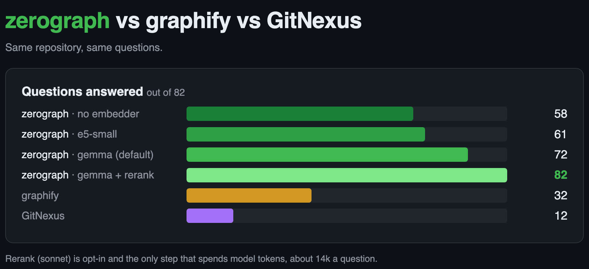

<div align="center">

# zerograph

**A project knowledge graph that costs zero API tokens to build, keep fresh, and query.**

[](https://www.npmjs.com/package/zerograph)
[](https://github.com/devmaxxx/zerograph/actions/workflows/ci.yml)
[](docs/mcp.md)
[](LICENSE)


</div>

`zerograph` reads a repository's markdown and code in 24 languages and extracts the structure the
authors already wrote: requirement ids, cross-references, exports, imports, calls, decorators, and ids
quoted in comments. It answers questions about that structure in a few lines of text.

- **Zero tokens by default.** Build, refresh and query all run locally. `ask --rerank` is the only
  thing that spends model tokens, and only when asked.
- **Finds the entry point from plain words.** Exact id, BM25 and local dense retrieval find it in
  about 200 tokens an answer.
- **Built for agents.** Every reader takes `--json`, there is an MCP server, and a session hook keeps
  the graph fresh.

[](docs/bench/2026-09-04-three-graphs-results.md)

## Get started

```bash
npm install -g zerograph                   # or: pnpm add -D zerograph
echo .zerograph/ >> .gitignore             # the graph is built per checkout
zerograph build                            # first run downloads the embedding model
zerograph ask cancellation policy          # stays fresh with your edits
zerograph install-agent --claude           # optional: MCP server + session hook
```

`install-agent` also takes `--codex`, `--cursor`, `--copilot`, `--gemini` and `--opencode`. On
Windows, see the [Windows notes](docs/install.md#windows-notes).

## Claude Code plugin

A status mod for Claude Code puts the index's state under the prompt: `◇ zerograph · in sync`, a
progress bar while a refresh runs, the files behind and whether `serve` answers. `/zerograph`
prints the full `zerograph status` report.

```
/plugin install zerograph --marketplace devmaxxx/zerograph
```

It is pinned to the latest release, so `claude plugin update zerograph` moves it with zerograph.
See [the status mod](docs/install.md#claude-code-status-mod).

## In action

```
$ zerograph ask cancellation
packages/db/src/schema/salon/scheduling.ts:110  CANCELLATION_CONSEQUENCES
docs/.../BE-M10-payments-provider-stripe-connect-….md:80  BE-M10/T05  Cancellation policy engine (`packages/domain/policy.ts`): inputs policy + appoin…
  └ docs/.../BE-M10-payments-provider-stripe-connect-….md:1  BE-M10  BE-M10 Payments provider: Stripe Connect implementation…
```

Each line reads `path:line  [ID]  headline`. Top-level lines are the matched seeds, and `└` lines are
neighbours one hop away.

```bash
zerograph ask FR-PAY-22                    # an exact id or symbol goes straight to the node
zerograph impact StaffService              # callers by depth, importing files, a risk line
zerograph trace StaffController StaffService   # shortest call chain between two symbols
zerograph changes --base main              # what the diff touches, and who reaches it
zerograph explain FR-PAY-22                # one node and everything attached to it
```

## Worktrees

Each checkout keeps its own graph and index in `.zerograph/` (nodes, edges, BM25 and its vectors),
so worktrees, clones and branches never share state or see each other's edits. The only thing
shared is a cache of embeddings.

- **A new worktree builds in seconds.** The cache (`~/.cache/zerograph/vectors`) holds text hash →
  vector per model and nothing else: no paths, edges or branches. A checkout copies the hits into its own
  `vectors.f32` and embeds only the misses, so a new worktree or clone embeds only the rows no
  checkout here has embedded before. On zerograph itself, a clone builds in 1.5 s instead of 46 s,
  with the same answers.
- **Parallel agents are safe.** One writer lock per checkout means two agents in one worktree never
  write at once. Agents in different worktrees never wait on each other.
- **One resident process per checkout.** `serve` sockets live under `~/.cache/zerograph/sock`, keyed
  by checkout, so a `serve` in one worktree never answers for another.

The cache is capped by `vector_cache_max` (default `4G`). `zerograph cache status` shows what it
holds and `zerograph cache prune` trims it. See [the vector cache](docs/keeping-fresh.md#the-vector-cache).

## Docs

- **Use it:** [install](docs/install.md), [commands](docs/commands.md),
  [keeping fresh](docs/keeping-fresh.md), [serve](docs/serve.md), [MCP](docs/mcp.md),
  [configuration](docs/configuration.md)
- **Understand it:** [how it works](docs/how-it-works.md), [the graph model](docs/graph-model.md),
  [languages](docs/languages.md), [embeddings](docs/embeddings.md), [rerank](docs/rerank.md)

## Contributing

Issues and pull requests are welcome. Before opening a pull request, run `cargo test` and
`cargo clippy --all-targets -- -D warnings`. A change to retrieval is judged by the
[three-way rule](docs/bench/runbook.md#judging-a-retrieval-change-the-three-way-rule).

## License

[MIT](LICENSE).
